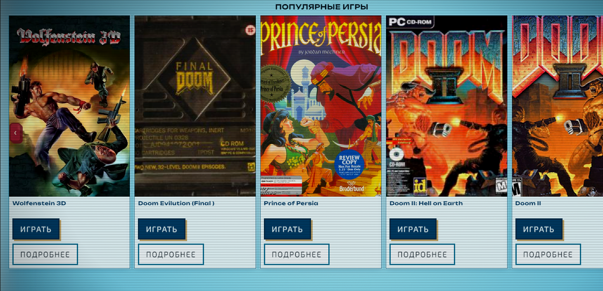

# RETRO GAMES

Библиотека старых DOS-игр, которые запускаются **прямо в браузере**, и конвертер
ретро-игр в автономные **`.EXE`** и **`.APK`**. Без аккаунтов, регистрации, тарифов
и подписок: открыл сайт — играешь или собираешь файл.

```
Flask + SQLite  →  каталог игр, загрузка, бандлы .jsdos, сборка .EXE/APK
Браузер         →  js-dos (DOSBox WASM), сохранения в OPFS браузера
```



## Что умеет

- **Библиотека игр** — обложки, описания, размеры, «популярные», поиск по каталогу.
- **Запуск в браузере** — js-dos внутри страницы; запуск открывается в модалке,
  оформленной как ламповый телевизор (корпус, кинескоп, скан-линии, ручки).
- **Загрузка игр** — архив `.zip`, `.7z`, `.rar` или готовый `.jsdos`; также импорт
  из папки `games/` на сервере.
- **Сборка `.EXE`** — один файл: игра + DOSBox Staging + лаунчер (PyInstaller).
- **Сборка `.APK`** — универсальный Android-плеер и отдельный APK на каждую игру
  (WebView-обёртка над веб-плеером).
- **Установка как приложение (PWA)** — иконка на главном экране, офлайн-кэш оболочки.
- **Проверка запуска** — перед публикацией игра проверяется в настоящем js-dos;
  если в браузере чёрный экран, ставится пометка «только .EXE».
- **Безопасность загрузок** — ClamAV/Defender/VirusTotal, проверка политики файлов,
  карантин опасных файлов (`.scr`, `.msi`, `.dll` и т. п.) без отклонения архива.
- **Админка** — только с этого компьютера (`localhost`), без пароля.

## Быстрый старт

```bat
python -m pip install -r requirements.txt
python app.py
```

Откройте <http://127.0.0.1:5000>. Вход не нужен — библиотека открыта сразу.

Порт и адрес можно задать:

```bat
python app.py --host 0.0.0.0 --port 8080
```

## Что поставить дополнительно

Всё опционально — без этого работают браузерные игры.

| Возможность | Что нужно |
|---|---|
| Сборка `.EXE` | `python -m pip install pyinstaller` + DOSBox Staging (путь в настройках админки) |
| Сборка `.APK` | Android SDK (build-tools с `aapt2`, `d8`, `zipalign`, `apksigner`) и JDK 17 |
| Антивирусная проверка | ClamAV (`clamscan`) или Windows Defender; ключ VirusTotal — `RETRO_VIRUSTOTAL_KEY` |
| HTTPS | обратный прокси (nginx/Caddy) или туннель |

## Как добавить игру

1. Откройте **«Загрузить»** и выберите архив с DOS-игрой.
2. Сервер распакует архив, найдёт `.EXE/.COM/.BAT`, проверит файлы и соберёт бандл.
3. Опасные для Windows файлы (`.scr`, `.msi`, `.dll`, скрипты) **убираются в карантин**:
   они остаются на сервере, но не попадают ни в браузерную игру, ни в `.EXE`/APK.
4. Игра получает статус **«на проверке»** и не показывается в публичной библиотеке,
   пока администратор не запустит проверку (см. ниже).

Импорт из папки: положите архивы в `games/` (или папку из `RETRO_GAMES_DIR`) и
запустите импорт в админке.

## Проверка запуска

На странице игры (локально, в админке) есть кнопка **«▶ Проверить в браузере»**:
сервер открывает игру в настоящем js-dos, ждёт появления изображения и ставит вердикт.

| Вердикт | Что значит |
|---|---|
| `ok` | игра запускается в браузере |
| `exe_only` | чёрный экран в браузере: карточка получает бейдж «только .EXE», главная кнопка ведёт на скачивание `.EXE` |
| `pending` | на проверке, скрыта из публичной библиотеки |

Вердикт можно выставить и вручную кнопками «Запускается» / «Только .EXE».

Известное ограничение: часть игр (например, Abuse и Aladdin) не запускается в
WASM-сборках DOSBox ни с каким конфигом — для них остаётся `.EXE`.

## Сборка `.EXE`

Кнопка **«Скачать .EXE»** на странице игры. Внутрь упаковываются игра, DOSBox Staging
и лаунчер; при первом запуске рядом создаётся папка с сохранениями и файл
`КАК_ИГРАТЬ.txt`. Сборка занимает 40–90 секунд, готовый файл кешируется.

## Сборка `.APK`

Страница **«Приложения»**:

- **Универсальный плеер** — `/apps/player.apk`, открывает веб-библиотеку на телефоне.
- **APK на игру** — кнопка «Скачать APK» на странице игры, открывает сразу эту игру.

APK — это WebView-обёртка: телефон должен иметь доступ к сайту. В админке задайте
**«Публичный адрес сайта»** (IP или домен), иначе APK возьмёт адрес, с которого его
скачали. Ключ подписи создаётся один раз в `data/android/retro.keystore` — сохраните его,
иначе обновления APK не установятся поверх.

## PWA

`/manifest.webmanifest` и `/sw.js` дают установку сайта как приложения и офлайн-кэш.
Полноценные PWA-возможности требуют **HTTPS** или `localhost`. При открытии по
`http://<IP>` браузер запрещает `navigator.storage`; для этого случая встроен
шиме в памяти, но сохранения игр в таком режиме недоступны.

## Админка

Доступна **только с локального компьютера** (`127.0.0.1`/`localhost`) и без пароля —
для удалённых посетителей её просто нет. Разделы:

- **Настройки сайта** — название, описание, тема, проверка загрузок, карантин.
- **Контент главной** — заголовки, шаги, преимущества, тексты.
- **Тарифы** — редактор страницы тарифов (в простом режиме страница отключена,
  но настройка осталась для совместимости).
- **Оплата** — настройки платёжного режима (в простом режиме не используется).
- **Пользователи** — остались от прежней версии; в простом режиме не нужны.
- **Игры** — редактирование карточек, обложки, команды запуска, проверка, удаление.
- **Журнал** — события сервера.

## Настройки окружения

| Переменная | Назначение | По умолчанию |
|---|---|---|
| `RETRO_HOST` | адрес прослушивания | `127.0.0.1` |
| `RETRO_PORT` | порт | `5000` |
| `RETRO_DATA_DIR` | папка данных | `./data` |
| `RETRO_GAMES_DIR` | папка для импорта игр | `./games` |
| `RETRO_SECRET` | секрет сессий Flask | локальный |
| `RETRO_HTTPS` | помечать cookie как Secure (за HTTPS-прокси) | выкл. |
| `RETRO_QUOTA_GB` | квота загрузок, ГБ | `10` |
| `RETRO_DRAFT_TTL_HOURS` | срок жизни незаконченных загрузок | `48` |
| `RETRO_VIRUSTOTAL_KEY` | ключ VirusTotal для проверки хешей | — |

## Команды

```bat
python app.py --host 0.0.0.0 --port 8080   :: запуск
python app.py --prune-drafts 24            :: удалить брошенные загрузки старше 24 ч
python app.py --rebuild-bundles all        :: пересобрать бандлы из файлов игр
python app.py --rebuild-bundles <id>       :: пересобрать один бандл
python app.py --scan-all                   :: перепроверить все игры антивирусом
python app.py --fix-bundles                :: добавить русскую кодовую страницу в бандлы
```

Ключи `--admin-user/--admin-password/--reset-admin/--check-admin/--list-users`
остались от версии с авторизацией и в простом режиме не используются.

## Данные

```
data/
  library.sqlite3      каталог игр, статусы проверки, история сборок
  site.json            настройки сайта и тексты
  games/<id>/
    files/             распакованная игра
    bundle.jsdos       бандл для js-dos
    cover.jpg          обложка
    quarantine/        вырезанные опасные файлы (не отдаются)
    builds/            собранные .exe
  android/             keystore и кеш APK
  logs/                журнал
```

## Безопасность

- Админка ограничена локальными запросами; снаружи прав администратора нет.
- Загрузка открыта всем — если выставляете сайт в интернет, добавьте модерацию
  или ограничьте доступ прокси/авторизацией.
- Опасные типы файлов не отклоняют архив, а **изолируются в карантине** и не попадают
  в сборки; антивирусная проверка при этом сохраняется.
- HTML отдаётся с `no-store`, статика версионируется, POST-формы защищены CSRF-токеном.
- Собранный `.EXE` не исполняется на сервере — только у пользователя.

## Права на игры

Проект — оболочка для запуска. Права на игры принадлежат правообладателям:
загружайте только то, что вы вправе распространять. Для публичного размещения
библиотеки нужен собственный контент или свободные игры (freeware/abandonware
по лицензии).
